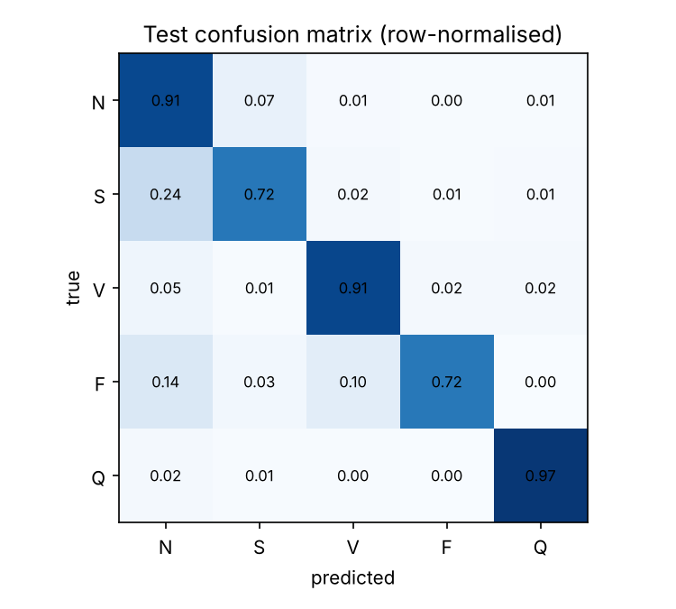

# ECG heartbeat classification (1D CNN)

Five-class single-beat classifier (N normal, S supraventricular, V ventricular, F fusion, Q unknown) on preprocessed MIT-BIH arrhythmia beats, with a small 1D convolutional network and a web demo.

> **Research prototype. Not a medical device. Not for clinical use.** Trained and tested only on a public dataset; no patient data is included in this repository.

**Demo:** a Gradio app is in `demo/` (see Run it below). There is no hosted version yet.

## Results (dataset test file, 21,892 beats)

| Metric | Value |
|---|---|
| Accuracy | 90.5% |
| Macro F1 | 0.746 |
| Macro AUC (one-vs-rest) | 0.972 |

| Class | Recall | Precision | AUC | Test beats |
|---|---|---|---|---|
| N | 90.6% | 98.5% | 0.977 | 18,118 |
| S | 72.3% | 22.7% | 0.906 | 556 |
| V | 91.1% | 85.9% | 0.994 | 1,448 |
| F | 72.2% | 52.9% | 0.985 | 162 |
| Q | 97.1% | 92.0% | 0.999 | 1,608 |



Overall accuracy is dominated by the normal class (83% of test beats). The weak point is precision for S: 1,342 normal beats are labelled supraventricular. Full numbers in `results/metrics_summary.json`.

Run-to-run variation is large for this model. An earlier run with the same code and seed settings stopped later and gave 95.6% accuracy and macro F1 0.821, with S recall 58.5% and S precision 76.8%. The numbers above are from the run that produced the saved model. The confusion matrix figure was regenerated from the confusion matrix counts of that run.

## Method

- Data: Kaggle `shayanfazeli/heartbeat`, MIT-BIH arrhythmia beats segmented to 187 samples (125 Hz). The dataset's own train and test files are used. 10% of train is held out for validation and early stopping.
- Model: three Conv1D blocks (32, 64, 128 filters; kernel 7, 5, 3) with batch normalisation, max pooling, global average pooling, dropout 0.3 and a softmax output. Adam 1e-3, softened class weights, early stopping on validation loss.

## Limitations (read before quoting the numbers)

- The dataset's train and test files are not split by patient, so beats from the same recordings can appear in both. Patient-independent protocols (for example the AAMI/de Chazal inter-patient split) give lower scores, so these numbers are optimistic.
- Single-beat classification of pre-segmented beats: no rhythm context and no beat detection from raw ECG.
- Strong class imbalance; read the per-class recall, not just accuracy. The validation loss during training was unstable between epochs, and early stopping restored the best epoch.
- One source database with a small number of subjects and no external validation.

## Run it

Train (Google Colab, free T4 GPU): open `ecg_arrhythmia_training.ipynb` and run all cells. It saves `ecg_cnn.keras` and `metrics.json`.

Demo locally:

```bash
cd demo
pip install -r requirements.txt
# put ecg_cnn.keras in this folder
python app.py
```

Paste 187 comma-separated values (one beat) or upload a CSV whose first row is one beat.

## Author

Abdullah Ghani, data and AI engineering student at ECE Paris.
